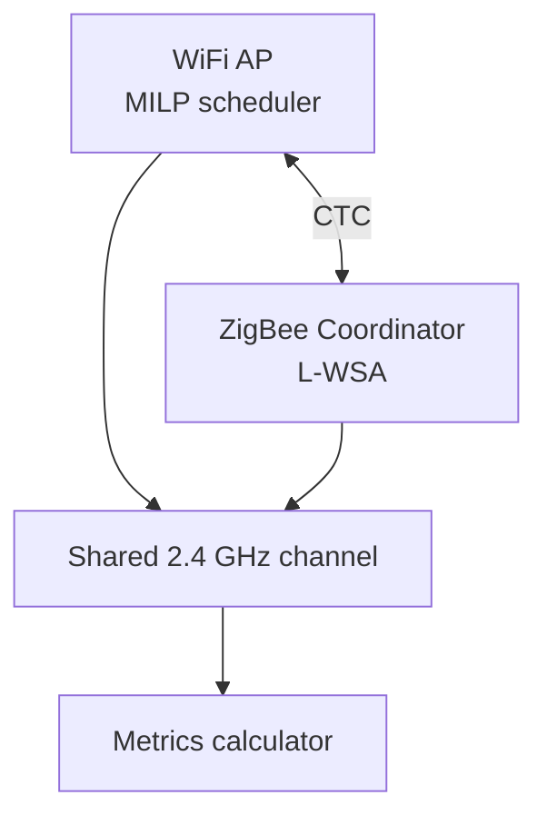
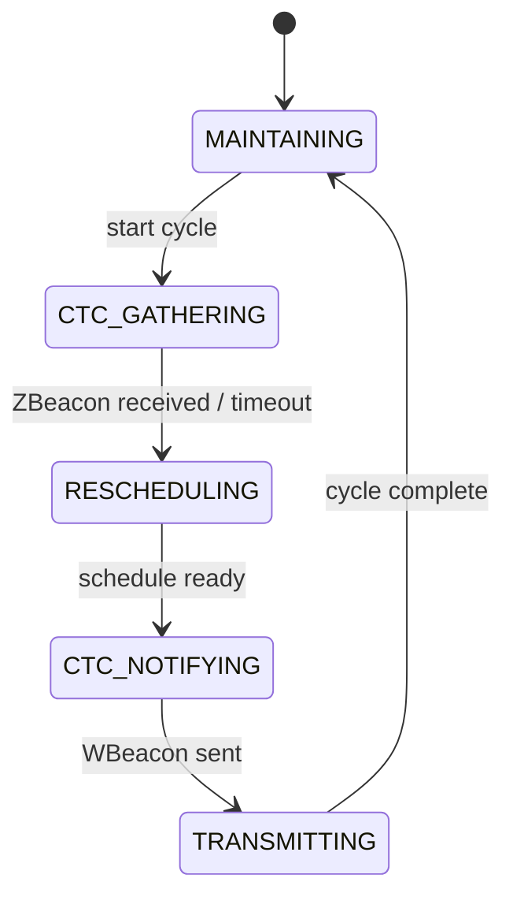
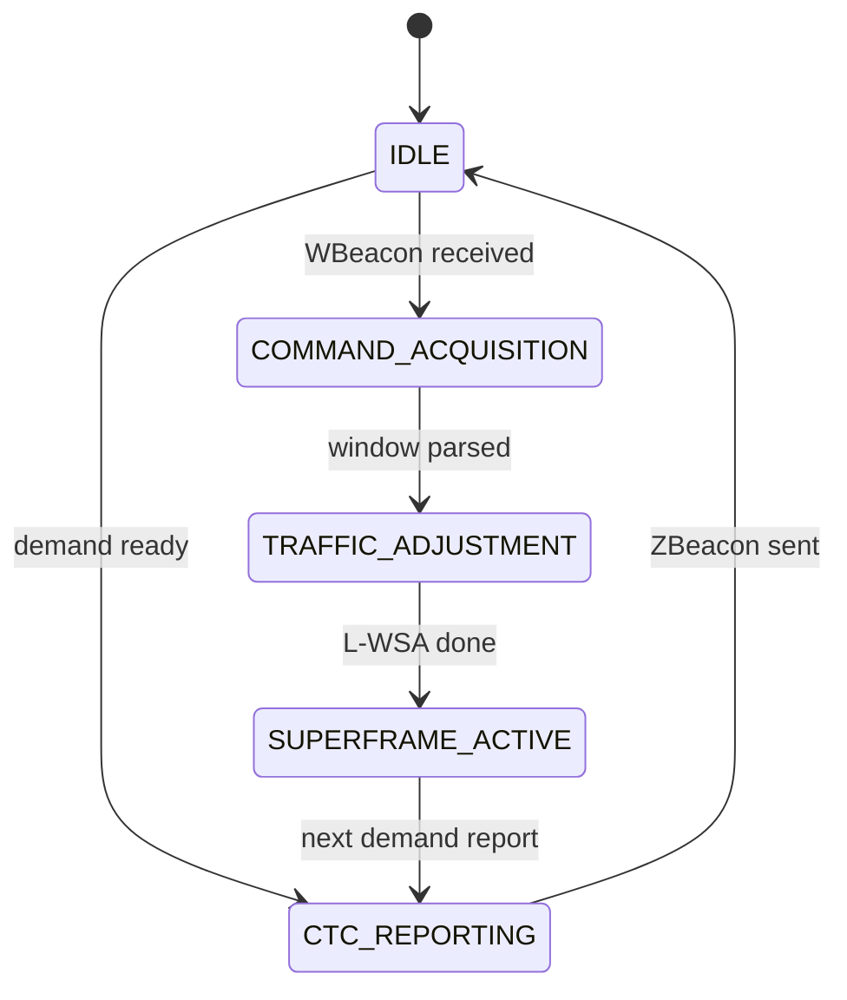

# CoWiC-MAC: Project Technical Document

**Project:** CoWiC-MAC Case Study  
**Document:** `reviews/project_document.md`  
**Authors:** Upayan Mazumder (24BDS0367), Nitesh Pandey (24BCB0141), Divyansh Saxena (24BCB0108)  
**Base paper:** Cheng, T., Li, S., and Pan, Y. "CoWiC-MAC: A Coordinated WiFi-Centric MAC Mechanism in Heterogeneous Wireless Networks." _Computer Networks_, Vol. 287, Art. 112479, Sept. 2026. DOI: [10.1016/j.comnet.2026.112479](https://doi.org/10.1016/j.comnet.2026.112479)

---

## 1. Problem Statement

WiFi (IEEE 802.11) and ZigBee (IEEE 802.15.4) share the 2.4 GHz ISM band. They use different MAC protocols. They cannot negotiate channel access with each other.

Uncoordinated operation causes Cross-Technology Interference (CTI). The base paper reports ZigBee packet loss above 60% and WiFi throughput loss near 20% under heavy shared-channel load.

CoWiC-MAC solves this with a WiFi-centric coordination loop:

1. The WiFi Access Point (AP) reschedules Frame Groups (FGs) with Mixed-Integer Linear Programming (MILP).
2. The ZigBee Coordinator (ZC) adapts its superframe with the Lightweight Window-Scaling Algorithm (L-WSA).
3. The two networks exchange control messages over Cross-Technology Communication (CTC).

This project builds a software-only simulation of that loop. It uses no radio hardware.

---

## 2. System Architecture

The system has three domains: the WiFi domain, the ZigBee domain, and the shared 2.4 GHz medium.



### End-to-end coordination cycle

1. The ZC reports demand with a ZBeacon (`d_free_ms`).
2. The AP solves the MILP and places a free window and a separate sensing window. The two windows do not overlap (Eq. 3).
3. The AP sends a WBeacon with window bounds.
4. The ZC runs L-WSA and builds a superframe that fits the free window.
5. Both sides transmit on the shared medium.
6. The channel medium records each transmission and marks overlaps as collisions. The metrics module reads these records after the run.

### ZigBee device scope

The current simulator represents ZigBee data traffic as one end device (`node_id=0`) coordinated by one ZC. It does not model five per-device queues, slotted CAP contention between devices, or per-device GTS allocation. The shared-medium collision model still detects overlaps between the simulated WiFi and ZigBee transmissions.

---

## 3. WiFi Domain

### 3.1 Frame Groups

A Frame Group (FG) is a batch of WiFi frames that the AP schedules as one unit. This matches the 802.11ax Target Wake Time (TWT) and trigger-frame model in the base paper.

Main fields:

| Field               | Meaning                          |
| ------------------- | -------------------------------- |
| `fg_id`             | Unique identifier                |
| `arrival_time_ms`   | Earliest time the FG may start   |
| `duration_ms`       | Airtime duration                 |
| `deadline_ms`       | Latest finish time               |
| `original_start_ms` | Start time before rescheduling   |
| `qos_sensitive`     | Flag for delay-sensitive traffic |

### Synthetic traffic traces: Table 5 against Fig. 9

`traces/synthetic_generator.py` builds one trace per traffic profile. It draws FG durations and natural whitespaces from exponential distributions with the Table 5 means. For an exponential whitespace $W$ with mean $\mu$, $P(W > t) = e^{-t/\mu}$.

The paper describes the whitespace in two ways. Table 5 gives the mean whitespace of each profile. Sec. 5.2 reads the Fig. 9 CCDF at 10 ms. The two descriptions do not agree.

| Statistic                                          | Traffic I | Traffic II | Traffic III | Traffic IV |
| -------------------------------------------------- | --------- | ---------- | ----------- | ---------- |
| Table 5 mean whitespace $\mu$ (ms)                 | 5.3       | 9.2        | 34.3        | 142.3      |
| Fig. 9 $P(W > 10\text{ ms})$ (Sec. 5.2 text)       | 79.2 %    | 65.9 %     | not given   | 4.1 %      |
| Generator $e^{-10/\mu}$                            | 15.2 %    | 33.7 %     | 74.7 %      | 93.2 %     |
| Generator, measured (seed 42, 600 s)               | 15.6 %    | 33.9 %     | 74.2 %      | 92.9 %     |
| Markov upper bound $\mu / 10$                      | 53 %      | 92 %       | no limit    | no limit   |

The measured row is `whitespace_ccdf_10ms` from `summarize_trace`. To get it, run `python -m traces.synthetic_generator --profile <name> --output <file>`. The defaults are seed 42 and 600 s.

**Infeasibility proof.** Markov's inequality applies to every non-negative random variable: $P(W \ge t) \le E[W] / t$. Thus $P(W > 10\text{ ms}) \le \mu / 10$. For Traffic I, $\mu = 5.3$ ms gives $P(W > 10\text{ ms}) \le 53\%$. Fig. 9 gives 79.2 %. No whitespace distribution with the Table 5 mean of Traffic I can give the Fig. 9 value. A short/long mixture is also a non-negative distribution, so a mixture cannot match it either.

Traffic II (65.9 % against a bound of 92 %) and Traffic IV (4.1 %) pass the bound. But for Traffic IV, the whitespaces longer than 10 ms must then have a mean of at least $(142.3 - 10 \cdot 0.959) / 0.041 \approx 3237$ ms. These gaps are more than three times the 1000 ms $T_{ZB}$ of Figs. 11 and 14.

**Ordering conflict.** The paper orders the load of the profiles in two opposite ways:

- Sec. 5.2 calls Traffic IV "high-intensity". It also says that the network goes "from sparse to saturation (Traffic I to IV)". The Fig. 9 tail values follow this order: they fall from Traffic I to Traffic IV.
- The Table 5 FG durations and whitespaces give the opposite order. The occupancy is $39.2 / (39.2 + 5.3) \approx 88\%$ for Traffic I and $25.8 / (25.8 + 142.3) \approx 15\%$ for Traffic IV. Sec. 5.3 calls Traffic I "high-load" (Fig. 11) and Traffic III "low-load" and "sparse" (Fig. 14).

If you swap the Fig. 9 labels (Fig. 9 Traffic I to Table 5 Traffic IV, and Fig. 9 Traffic IV to Table 5 Traffic I), the Markov bound no longer blocks a match. The paper does not state such a swap.

**Chosen reading.** The repo uses the Table 5 order and keeps the exponential generator. It does not add a whitespace mixture. The reasons are:

1. Table 5 is the only source that gives numbers for all four profiles.
2. Sec. 5.3, Fig. 11, and Fig. 14 use the Table 5 order. The benchmark replicates these figures.
3. In the Table 5 order, no distribution can match Fig. 9 for Traffic I (see the proof). A mixture can fit only Traffic II and Traffic IV, and the Traffic IV fit needs gaps longer than 3 s.
4. A label swap of Fig. 9 is a guess. The paper does not support it.

**Effects on the results.** The generator gives fewer long whitespaces under heavy load than Fig. 9 shows. On Traffic I, $P(W \ge 31\text{ ms}) = e^{-31/5.3} \approx 0.3\%$. Exp 1, Exp 2, and the whitespace expansion fallback use this tail directly. Thus the Exp 1 and Exp 2 values on Traffic I can be lower than the paper values. The generator is an i.i.d. renewal process. It does not reproduce the burstiness of Fig. 10.

`tests/test_trace_generator.py` checks `whitespace_ccdf_10ms` against $e^{-10/\mu}$ for each profile. The absolute tolerance is 0.015. This is approximately 3.5 binomial standard errors on the smallest trace (Traffic IV, 3642 whitespaces). The test file also checks the Markov argument above.

### 3.2 MILP Scheduler (Equations 11-17)

The AP solves this programme each cycle:

```math
\min \sum_{k=1}^{K} z_k^{\text{free}} d_k
+ \gamma \sum_{k=1}^{K} z_k^{\text{sense}} d_k
+ \lambda \sum_{k=1}^{K} y_k
+ \sum_{k=1}^{K} \mu_k P_k
```

Postponement cost (Eq. 2), larger for FGs close to their deadline:

```math
\mu_k = \frac{\mu_{\text{base}}}{\max\left(\epsilon,\ e_k - (T_{\text{end}} + d_k)\right)}
```

The code uses $\mu_{\text{base}} = 100$ and $\epsilon$ = 1 µs.

Decision variables:

- $T_{\text{free}}^{\text{start}}, T_{\text{sensing}}^{\text{start}}$ — window start times
- $b_{\text{ws}}$ — window-ordering binary: which window comes first
- $s'_k$ — scheduled start time of FG $k$
- $y_k$ — delay relative to the original start
- $z_k^{\text{free}}, z_k^{\text{sense}}$ — overlap indicators with free and sensing windows
- $P_k$ — postpone binary (defer into the next cycle)
- $b_{kj}$ — ordering binary between FG pairs

Constraint groups:

0. Window placement (Eq. 3/13): both windows lie inside the cycle and do not overlap. $T_{\text{free}}^{\text{end}} \le T_{\text{sensing}}^{\text{start}} + M(1 - b_{\text{ws}})$ and $T_{\text{sensing}}^{\text{end}} \le T_{\text{free}}^{\text{start}} + M b_{\text{ws}}$
1. Delay definition: $y_k \ge s'_k - s_k$, $y_k \ge 0$
2. Causality: $a_k \le s'_k + M P_k$
3. Deadline and cycle bound: $s'_k + d_k \le e_k + M P_k$ and $s'_k + d_k \le T_{\text{end}} + M P_k$
4. Feasibility of postponed FGs: $T_{\text{end}} + d_k \le e_k + M(1 - P_k)$
5. Inter-FG non-overlap via Big-M ordering binaries $b_{kj}$
6. Overlap indicators $z_k^{\text{free}}$ and $z_k^{\text{sense}}$. Eq. 16, as printed, forces $z_k = 1$ for an FG that does not overlap the window, which contradicts constraint 7. The code uses a disjunctive form instead: if $z_k = 0$, the FG lies entirely before or entirely after the window
7. Sensing window protection: $\sum_{k=1}^{K} z_k^{\text{sense}} = 0$

Solver: PuLP with HiGHS (`highspy`). A custom PuLP solver can be supplied; if the MILP has no optimal solution, the AP uses whitespace expansion fallback.

### 3.3 AP Orchestrator State Machine



States:

| State           | Action                |
| --------------- | --------------------- |
| `MAINTAINING`   | Idle between cycles   |
| `CTC_GATHERING` | Collect ZigBee demand |
| `RESCHEDULING`  | Run MILP or fallback  |
| `CTC_NOTIFYING` | Send WBeacon          |
| `TRANSMITTING`  | Drive WiFi airtime    |

### 3.4 Baseline Experiments (Exp 1-3)

| Exp   | Name          | Behaviour                                                                                                    |
| ----- | ------------- | ------------------------------------------------------------------------------------------------------------ |
| Exp 1 | Uncoordinated | No CTC. No rescheduling. ZigBee uses a fixed superframe at the cycle start. Carrier sensing is not modelled. |
| Exp 2 | Opportunistic | AP senses natural idle gaps. No WiFi rescheduling.                                                           |
| Exp 3 | ECC           | NAV-based reservation. Fixed ZigBee superframe.                                                              |

---

## 4. ZigBee Domain

### 4.1 IEEE 802.15.4 Superframe

A beacon-enabled superframe has:

- 1 beacon slot
- $i$ Contention Access Period (CAP) slots
- $j$ Contention Free Period (CFP) slots

Hard limits from the standard and the base paper:

- $0 \le j \le 7$
- $i + j \le 15$
- Total active slots: $1 + i + j$

IEEE 802.15.4 2.4 GHz O-QPSK PHY constants used in this project:

| Constant            | Value                  |
| ------------------- | ---------------------- |
| Symbol duration     | 0.016 ms               |
| Base slot duration  | 0.96 ms (60 symbols)   |
| Backoff slot        | 0.32 ms (20 symbols)   |
| Turnaround time     | 0.192 ms (12 symbols)  |
| ACK duration        | 0.352 ms (22 symbols)  |
| Max packet duration | 4.256 ms (266 symbols: 127-byte PSDU plus 6-byte SHR/PHR) |

### 4.2 L-WSA Algorithm (Algorithm 2)

The ZC maximises:

```math
\eta_{\text{total}}
= m \cdot t_{\min} \cdot \eta_{\text{cap}}^{p}
+ \alpha \cdot n \cdot t_{\text{SfSlot}} \cdot \eta_{\text{cfp}}^{p}
```

Search variables:

| Variable            | Domain                                                                |
| ------------------- | --------------------------------------------------------------------- |
| $t_{\text{SfSlot}}$ | `BASE_SLOT * 2^SO`, $SO \in [0, 14]$                                  |
| $j$ (CFP slots)     | $[0, 7]$                                                              |
| $i$ (CAP slots)     | $i + j \le 15$                                                        |
| $t_{\text{offset}}$ | Window start, or end of each residual WiFi fragment inside the window |

Filter: $(1 + i + j) \cdot t_{\text{SfSlot}} \le$ free-window duration. Each candidate slot must avoid residual WiFi fragments $\mathcal{T}^{\text{WiFi}}$. CAP attempts are counted at $t_{\min}$ stride.

### 4.3 ZigBee Coordinator State Machine



---

## 5. Cross-Technology Communication

CTC lets WiFi and ZigBee exchange control messages without a shared MAC.

| Message | Direction | Payload keys                                                             |
| ------- | --------- | ------------------------------------------------------------------------ |
| ZBeacon | ZC → AP   | `d_free_ms`                                                              |
| WBeacon | AP → ZC   | `t_free_start_ms`, `t_free_end_ms`, `t_sense_start_ms`, `t_sense_end_ms` |

Physical-layer CTC primitives in the base paper:

- **WiCast** — WiFi → ZigBee downlink by payload emulation
- **SymBee** — ZigBee → WiFi uplink by phase-shift symbol patterns

This software model abstracts CTC as discrete-event messages with a configurable packet error rate (PER). It does not emulate RF waveforms.

---

## 6. Shared Channel Model

`ChannelMedium` records every WiFi and ZigBee transmission interval. A collision occurs when intervals overlap beyond `OVERLAP_TOLERANCE_MS`.

The medium stores one record per transmission: protocol, start time, end time, and a success flag.

The metrics module computes airtime, delay, jitter, and drops after the run. It uses these records and the WiFi scheduling decisions of the engine.

---

## 7. Experiments

| Exp   | Config                    | What it tests           | Fixed parts                          |
| ----- | ------------------------- | ----------------------- | ------------------------------------ |
| Exp 1 | `exp1_uncoordinated.yaml` | Uncoordinated baseline  | No CTC, no MILP, no L-WSA            |
| Exp 2 | `exp2_opportunistic.yaml` | Natural whitespace only | No WiFi rescheduling                 |
| Exp 3 | `exp3_ecc.yaml`           | NAV-style ECC           | Fixed ZigBee superframe              |
| Exp 4 | `exp4_cowic_full.yaml`    | Full CoWiC-MAC          | Soft MILP + L-WSA + sensing window   |
| Exp 5 | `exp5_rigid_vacate.yaml`  | Hard-constraint vacate  | Hard MILP + fixed ZigBee superframe  |
| Exp 6 | `exp6_overhead_free.yaml` | Overhead-free variant   | Soft MILP + L-WSA; no sensing window |

Exp 6 also changes CTC from bidirectional to WiFi-to-ZigBee.

### Parameter sweep

| Stage     | Paper figure | Experiments | Traffic          | $T_{ZB}$ (ms)    | $D_{\text{free}}$ (ms) | $D_{\text{sensing}}$ (ms) |
| --------- | ------------ | ----------- | ---------------- | ---------------- | ---------------------- | ------------------------- |
| Main      | Figs. 11–14  | Exp 1–6     | I and III        | 1000, 2000, 5000 | 31, 62, 93, 123        | Config value              |
| Occupancy | Fig. 15      | Exp 1–6     | I, II, III, IV   | 1000             | 63                     | Config value              |
| Sensing   | Figs. 16, 17 | Exp 4       | I and III        | 1000             | 31, 62, 93, 123        | 10, 20, 50, 100           |

Each run replays 600 s of trace by default, with 5 seeds. `--seeds N` and `--duration` make a smaller grid.

**Acceptance:** `acceptance_report` checks every $G_z$ and $PDR_w$ value that Sec. 5.3.1 states for Exp 4, 5 and 6 (Fig. 11). The tolerance is ±0.02 for $G_z$ and ±0.005 for $PDR_w$.

### Fidelity at high load (Issue #60)

A 10 s run of Exp 4 on Traffic I with $D_{\text{free}} = 123$ ms (seed 42) gave $PDR_w$ = 2.57 % and $G_z$ = 0.549 before Issue #60. A cycle-by-cycle trace of that run found these causes:

1. **ZigBee sent into sensed WiFi.** L-WSA counts only clear CAP attempts and CFP slots (Eq. 9/10), and Sec. 4.4 says that it "selectively utilizes only interference-free intervals". The engine still sent every attempt. Three WiFi FGs that the soft MILP kept in the window collided. The engine now defers an attempt that overlaps a sensed fragment, and the queued packet uses the next clear attempt.
2. **Scheduler-only drops at the cycle end.** Eq. 4 asks a kept FG to end by $T_\text{end}$. An FG whose original airtime crosses $T_\text{end}$ can not do that. With $D_\text{free} = 0$ (no ZigBee window at all), 30 s of Traffic I lost 2 FGs that the unscheduled trace carries. A kept FG may now end after $T_\text{end}$, but not after its original end.
3. **Postponed sets that do not fit.** Eq. 14 checks each postponed FG alone, so several FGs can each pass while the set does not fit the start of the next cycle. With only this check, the 10 s run dropped two FGs one cycle after their postponement. The MILP now also requires earliest-deadline-first feasibility of the postponed set (Sec. 4.3: a postponed FG "must remain schedulable in the next cycle"). With this check, neither FG is dropped. A unit test pins a two-FG case: each FG fits alone, the pair does not.
4. **Solver time limit.** Three of ten cycles reached the 10 s limit. One of them returned drops that the proven optimum does not need, so the AP used the fallback, which dropped two QoS FGs. Fixed order binaries (an exact reduction) and a zero relative MIP gap now let that cycle prove optimality in about 2 s.

After these fixes, the same 10 s run drops 1 FG instead of 3, and $PDR_w$ falls from 2.57 % to 0.92 %. The run has no WiFi collisions. $G_z$ is 0.515 (was 0.549). Two fixes limit ZigBee: the joint postponement check forbids some postponements, and ZigBee no longer sends into WiFi airtime. This run does not separate their shares. Without ZigBee windows (30 s, $D_\text{free} = 0$), the scheduler drops no FG.

Two limits remain. They are properties of the scenario, not defects:

- **Capacity.** Traffic I is about 88 % busy. $D_\text{free} = 123$ ms plus $D_\text{sensing} = 10$ ms adds 13.3 % of each 1000 ms cycle. The total is about 101 %, so no schedule can give full $G_z$ and zero WiFi loss at the same time. The paper reports both ($G_z$ 93.4–94.7 % with zero loss).
- **Postponement cost.** The paper does not give $\lambda$, $\gamma$ or $\mu_\text{base}$. The repo uses $\lambda = 1$, $\gamma = 10$, $\mu_\text{base} = 100$. A postponed FG near a cycle end can still fail to fit the start of the next cycle, because the AP does not see later arrivals. $\mu_\text{base}$ sets the trade-off. Exp 4, Traffic I, 30 s, seed 42:

| $\mu_\text{base}$ | $D_\text{free}$ (ms) | Dropped FGs | $PDR_w$ | $G_z$ |
| ----------------- | -------------------- | ----------- | ------- | ----- |
| 100               | 31                   | 3           | 1.35 %  | 0.919 |
| 1000              | 31                   | 1           | 0.52 %  | 0.852 |
| 10000             | 31                   | 0           | 0.04 %  | 0.709 |
| 100               | 123                  | 9           | 2.68 %  | 0.508 |
| 1000              | 123                  | 5           | 2.21 %  | 0.415 |
| 10000             | 123                  | 0           | 0.10 %  | 0.165 |

No value gives the paper's $G_z$ and zero loss together. The repo keeps $\mu_\text{base} = 100$ and does not tune it to the paper. `tests/test_paper_points.py` (`pytest -m slow`) records each deviation as a strict `xfail` with its cause.

---

## 8. Key Metrics

| Metric           | Definition                                                      |
| ---------------- | --------------------------------------------------------------- |
| $G_z$            | Delivered ZigBee data payload / payload of the demand in a clean window, every cycle |
| $PDR_w$          | Airtime of deadline-dropped or collision-destroyed WiFi FGs / requested WiFi airtime |
| $U_{\text{eff}}$ | Successful WiFi + ZigBee + control airtime / simulated duration |
| Jitter           | Variation of WiFi FG delay                                      |
| Max delay        | Largest WiFi FG delay in the run                                |

### Hypotheses under test

1. Under heavy load, CoWiC-MAC achieves $G_z \ge 90\%$. Measured (60 s reference run): only at $D_\text{free} = 31$ ms, $G_z$ = 0.942 (see "Fidelity at high load").
2. CoWiC-MAC keeps $PDR_w = 0$ by deadline-aware postponement. Measured: not on Traffic I with $\mu_\text{base} = 100$ (see the table above).
3. Exp 5 changes the WiFi policy and ZigBee superframe. Exp 6 removes sensing and uses one-way WiFi-to-ZigBee CTC.

---

## 9. Software Stack

| Layer        | Choice                      |
| ------------ | --------------------------- |
| Language     | Python 3.11+                |
| DES engine   | SimPy                       |
| MILP         | PuLP + HiGHS (`highspy`)    |
| Data         | NumPy, Pandas, PyYAML       |
| Plots        | Matplotlib                  |
| Tests        | pytest (263 tests)          |
| Lint / types | ruff, mypy                  |

---

## 10. Presentation Ownership

| Presenter       | Domain               |
| --------------- | -------------------- |
| Upayan Mazumder | Central architecture |
| Nitesh Pandey   | WiFi side            |
| Divyansh Saxena | ZigBee side          |

---

## 11. References

1. Bianchi, G. "Performance Analysis of the IEEE 802.11 Distributed Coordination Function." _IEEE JSAC_, 18(3), 2000.
2. Jamieson, K., and Balakrishnan, H. "PPR: Partial Packet Recovery for Wireless Networks." _ACM SIGCOMM CCR_, 37(4), 2007.
3. Huang, J., Xing, G., Zhou, G., and Zhou, R. "Beyond Co-existence: Exploiting WiFi White Space for ZigBee Performance Assurance." _ICNP_, 2010.
4. Liang, C.-J. M., Priyantha, N. B., Liu, J., and Terzis, A. "Surviving Wi-Fi Interference in Low Power ZigBee Networks." _SenSys_, 2010.
5. Zhang, X., and Shin, K. G. "Enabling Coexistence of Heterogeneous Wireless Systems: Case for ZigBee and WiFi." _MobiHoc_, 2011.
6. Wang, Y., et al. "WiCop: Engineering WiFi Temporal White-Spaces for Safe Operations of Wireless Personal Area Networks in Medical Applications." _IEEE TMC_, 13(5), 2014.
7. Guo, P., Cao, J., Zhang, K., and Liu, X. "Enhancing ZigBee Throughput under WiFi Interference Using Real-Time Adaptive Coding." _INFOCOM_, 2014.
8. Yang, P., et al. "Taming Cross-Technology Interference for Wi-Fi and ZigBee Coexistence Networks." _IEEE TMC_, 15(4), 2016.
9. Bellalta, B. "IEEE 802.11ax: High-Efficiency WLANs." _IEEE Wireless Commun._, 23(1), 2016.
10. Li, Z., and He, T. "WEBee: Physical-Layer Cross-Technology Communication via Emulation." _MobiCom_, 2017.
11. Deng, D.-J., et al. "IEEE 802.11ax: Highly Efficient WLANs for Intelligent Information Infrastructure." _IEEE Commun. Mag._, 55(12), 2017.
12. Yin, Z., Li, Z., Kim, S. M., and He, T. "Explicit Channel Coordination via Cross-Technology Communication." _MobiSys_, 2018.
13. Khorov, E., Kiryanov, A., Lyakhov, A., and Bianchi, G. "A Tutorial on IEEE 802.11ax High Efficiency WLANs." _IEEE Commun. Surveys & Tutorials_, 21(1), 2019.
14. Nurchis, M., and Bellalta, B. "Target Wake Time: Scheduled Access in IEEE 802.11ax WLANs." _IEEE Wireless Commun._, 26(2), 2019.
15. Pan, Y., Li, S., Zhang, Y., and Zhu, T. "CDA: Coordinating Data Dissemination and Aggregation in Heterogeneous IoT Networks Using CTC." _JNCA_, 171, 2020.
16. Shao, C., et al. "PolarScout: Wi-Fi Interference-Resilient ZigBee Communication via Shell-Shaping." _IEEE/ACM ToN_, 28(4), 2020.
17. Kim, S. "Enabling WLAN and WPAN Coexistence via Cross-Technology Communication." _Sensors_, 22(3), 2022.
18. Chen, W., Yin, Z., and He, T. "Enabling Global Cooperation for Heterogeneous Networks via Reliable Concurrent Cross Technology Communications." _IEEE TMC_, 21(11), 2022.
19. Cheng, T., Li, S., Jiao, F., and Pan, Y. "WibZig: Reliable and Commodity-Device Compatible PHY-CTC via Chip Emulation in Phase." _IPSN_, 2023.
20. Cheng, T., Li, S., Dang, W., and Pan, Y. "An Effective Data Dissemination Method in WAIC Networks Using Enhanced CTC." _Computer Networks_, 269, 2025.

**Base paper:** Cheng, T., Li, S., and Pan, Y. "CoWiC-MAC: A Coordinated WiFi-Centric MAC Mechanism in Heterogeneous Wireless Networks." _Computer Networks_, 287, Art. 112479, 2026.
