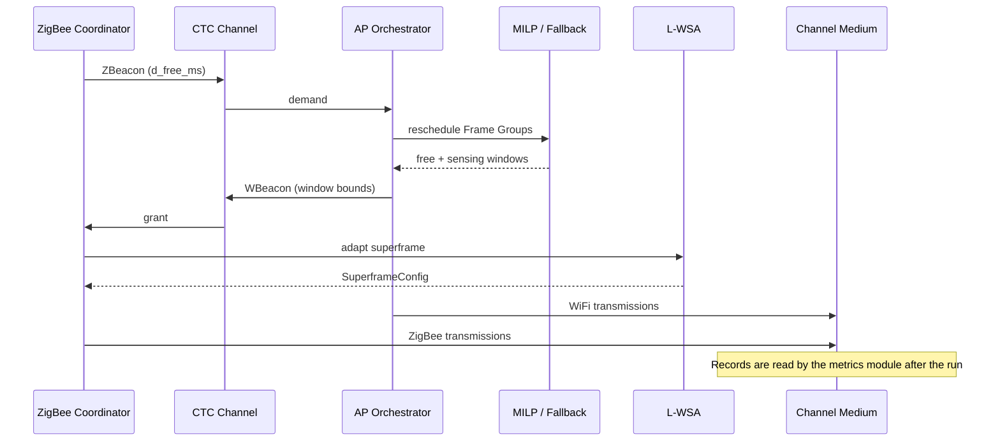

# F1+TF1 Computer Networks: Case Study Review 3

## 1. Case Study Title

### CoWiC-MAC: A Coordinated WiFi-Centric MAC Mechanism in Heterogeneous Wireless Networks

## Team Details

| S.No | Name            | Registration Number |
| ---- | --------------- | ------------------- |
| 1    | Upayan Mazumder | 24BDS0367           |
| 2    | Nitesh Pandey   | 24BCB0141           |
| 3    | Divyansh Saxena | 24BCB0108           |

---

## 2. Software Implementation Overview

This review documents the software-only CoWiC-MAC simulation built for the case study. The implementation follows Cheng, Li, and Pan (_Computer Networks_, 2026, Art. 112479).

Stack:

| Layer                 | Choice                      |
| --------------------- | --------------------------- |
| Language              | Python 3.11+                |
| Discrete-event engine | SimPy                       |
| MILP                  | PuLP + HiGHS (`highspy`)    |
| Tests                 | pytest                      |
| Lint / types          | ruff, mypy                  |

Verification status at document time:

- 260 automated tests passing
- CI green on Python 3.11 and 3.12
- Clean `mypy` and `ruff` checks

Implemented modules:

| Area       | Paths                                                                    |
| ---------- | ------------------------------------------------------------------------ |
| Models     | `src/cowic/models/frame_group.py`, `src/cowic/models/superframe.py`      |
| WiFi       | `ap_orchestrator.py`, `milp_scheduler.py`, `baselines.py`, `fallback.py` |
| ZigBee     | `coordinator.py`, `lwsa_adapter.py`                                      |
| CTC        | `src/cowic/ctc/channel.py`                                               |
| Simulation | `simulation_engine.py`, `channel_medium.py`                              |
| Analysis   | `metrics.py`, `plotter.py`                                               |
| Traces     | `traces/synthetic_generator.py`, `traces/playback.py`                    |
| Sweep      | `scripts/run_benchmark_sweep.py`                                         |

---

## 3. Contributor Workstream Summary

Presentation ownership matches Review 2.

| Contributor     | Presentation domain  | Main implementation focus                                                                                                   |
| --------------- | -------------------- | --------------------------------------------------------------------------------------------------------------------------- |
| Upayan Mazumder | Central architecture | Simulation engine, CTC, channel medium, MILP scheduler, L-WSA, plotter, integration                                         |
| Nitesh Pandey   | WiFi side            | Trace generator, AP orchestrator, baselines, fallback, hard-constraint MILP (Exp 5), engine fixes, metrics, benchmark sweep |
| Divyansh Saxena | ZigBee side          | ZigBee architecture review, superframe / L-WSA specification input, test design                                             |

---

## 4. System Architecture and Data Flow

The system has three domains: WiFi, ZigBee, and the shared 2.4 GHz medium. CTC joins the two MAC domains.



CTC payloads:

| Message | Direction | Fields                                                                   |
| ------- | --------- | ------------------------------------------------------------------------ |
| ZBeacon | ZC → AP   | `d_free_ms`                                                              |
| WBeacon | AP → ZC   | `t_free_start_ms`, `t_free_end_ms`, `t_sense_start_ms`, `t_sense_end_ms` |

Residual WiFi fragment lists stay outside the WBeacon scalar payload. The ZC receives them as a separate input, matching the base-paper model where the ZC senses leftover WiFi activity inside the granted window.

---

## 5. WiFi Frame Group MILP Formulation

Objective (Equations 11–17):

```math
\min \sum_{k=1}^{K} z_k^{\text{free}} d_k
+ \gamma \sum_{k=1}^{K} z_k^{\text{sense}} d_k
+ \lambda \sum_{k=1}^{K} y_k
+ \sum_{k=1}^{K} \mu_k P_k
```

Constraint groups:

1. Delay definition for $y_k$
2. Causality with respect to arrival times
3. Deadline and cycle-end bounds
4. Feasibility of postponed Frame Groups in the next cycle
5. Inter-FG non-overlap through Big-M ordering binaries
6. Overlap indicator constraints for free and sensing windows
7. Hard sensing-window protection: $\sum_k z_k^{\text{sense}} = 0$

Solver path: PuLP model solved with HiGHS (`highspy`). A custom solver can be supplied. If status is not optimal, the AP uses whitespace expansion fallback.

Postponed FG reporting convention: a postponed FG is reported at `scheduled_start_ms = t_end_ms` with `delay_ms = max(0, t_end_ms - original_start_ms)`.

---

## 6. ZigBee L-WSA Superframe Adaptation

Objective:

```math
\eta_{\text{total}}
= m \cdot t_{\min} \cdot \eta_{\text{cap}}^{p}
+ \alpha \cdot n \cdot t_{\text{SfSlot}} \cdot \eta_{\text{cfp}}^{p}
```

Search variables and domains:

| Variable            | Domain                                        |
| ------------------- | --------------------------------------------- |
| $t_{\text{SfSlot}}$ | $0.96 \cdot 2^{SO}$ ms, $SO \in [0, 14]$      |
| $j$                 | $[0, 7]$                                      |
| $i$                 | $i + j \le 15$                                |
| $t_{\text{offset}}$ | window start and residual-fragment boundaries |

Filter conditions:

- Active superframe duration must fit the free window.
- CAP slots contribute only when they clear a $t_{\min}$ occupancy check.
- CFP slots contribute only when the full slot clears residual WiFi.

IEEE 802.15.4 2.4 GHz O-QPSK constants used:

| Constant        | Value    |
| --------------- | -------- |
| Symbol duration | 0.016 ms |
| Base slot       | 0.96 ms  |
| Backoff slot    | 0.32 ms  |
| Turnaround      | 0.192 ms |
| ACK             | 0.352 ms |
| Max packet      | 4.256 ms (266 symbols: 127-byte PSDU plus 6-byte SHR/PHR) |

---

## 7. Cross-Technology Communication Model

The base paper uses WiCast for WiFi→ZigBee downlink and SymBee for ZigBee→WiFi uplink. This project does not emulate those waveforms.

Instead, CTC is a discrete-event control channel:

- Message types: `WBEACON`, `ZBEACON`
- Configurable packet error rate
- Scalar float payloads only

This abstraction is enough for MAC-layer coordination studies. It is not a PHY fidelity claim.

---

## 8. Experimental Design

| Exp   | Config                    | Purpose                   | Held fixed / disabled                |
| ----- | ------------------------- | ------------------------- | ------------------------------------ |
| Exp 1 | `exp1_uncoordinated.yaml` | Uncoordinated baseline    | No CTC, no MILP, no L-WSA            |
| Exp 2 | `exp2_opportunistic.yaml` | Natural whitespace only   | No WiFi rescheduling                 |
| Exp 3 | `exp3_ecc.yaml`           | NAV-style ECC             | Fixed ZigBee superframe              |
| Exp 4 | `exp4_cowic_full.yaml`    | Full CoWiC-MAC            | Soft MILP + L-WSA + sensing window   |
| Exp 5 | `exp5_rigid_vacate.yaml`  | Hard WiFi vacate ablation | Hard MILP + fixed ZigBee superframe  |
| Exp 6 | `exp6_overhead_free.yaml` | Overhead-free variant     | Soft MILP + L-WSA; no sensing window |

Exp 6 also changes CTC from bidirectional to WiFi-to-ZigBee.

Parameter sweep dimensions:

| Parameter            | Values                                              |
| -------------------- | --------------------------------------------------- |
| $D_{\text{free}}$    | 31, 62, 93, 123 ms                                  |
| $T_{ZB}$             | 1000, 2000, 5000 ms                                 |
| Traffic              | Traffic I and III by default; I–IV with `--traffic` |
| $D_{\text{sensing}}$ | 10, 20, 50, 100 ms                                  |
| Seeds                | 5                                                   |

Acceptance criterion: Exp 4 at $D_{\text{free}} = 31$ ms and $T_{ZB} = 1000$ ms must satisfy $G_z > 0.9$ and $PDR_w = 0$.

---

## 9. Evaluation and Key Claims

Hypothesis mapping:

| Hypothesis | Claim                           | Simulation support                                                                             |
| ---------- | ------------------------------- | ---------------------------------------------------------------------------------------------- |
| H1         | $G_z \ge 90\%$ under heavy load | Exp 4 with MILP + L-WSA                                                                        |
| H2         | $PDR_w = 0$                     | Deadline-aware MILP postponement                                                               |
| H3         | Compare variant configurations  | Exp 5 changes the scheduler and ZigBee superframe. Exp 6 removes sensing and uses one-way CTC. |

Observed quick-sweep acceptance point (Exp 4, Traffic I, $D_{\text{free}}=31$ ms, $T_{ZB}=1000$ ms):

- $G_z = 0.929$
- $PDR_w = 0.0000$
- Result: PASS

This point meets the Issue #11 high-load acceptance rule. It does not by itself claim that every $D_{\text{free}}$ value exceeds 0.9.

---

## 10. Limitations and Future Work

Known limitations of this software-only study:

1. No PHY fading, capture, or SNR model
2. CTC is an error-rate message model, not waveform CTC
3. No multi-hop ZigBee routing
4. No IEEE 802.11be multi-link operation
5. ZigBee data traffic uses one simulated end device (`node_id=0`); per-device queues, slotted CAP contention, and GTS allocation across five end devices are not modeled.

Useful extensions:

1. Export traces into ns-3 for RF-level checks
2. Add multi-ZC demand aggregation
3. Study 802.11be multi-link coexistence with the same MILP / L-WSA split
4. Replace abstract PER with measured CTC traces

---

## 11. References

1. Bianchi, G. "Performance Analysis of the IEEE 802.11 Distributed Coordination Function." _IEEE Journal on Selected Areas in Communications_, 18(3), pp. 535–547, 2000.
2. Jamieson, K., and Balakrishnan, H. "PPR: Partial Packet Recovery for Wireless Networks." _ACM SIGCOMM Computer Communication Review_, 37(4), pp. 409–420, 2007.
3. Huang, J., Xing, G., Zhou, G., and Zhou, R. "Beyond Co-existence: Exploiting WiFi White Space for ZigBee Performance Assurance." _ICNP_, 2010.
4. Liang, C.-J. M., Priyantha, N. B., Liu, J., and Terzis, A. "Surviving Wi-Fi Interference in Low Power ZigBee Networks." _SenSys_, 2010.
5. Zhang, X., and Shin, K. G. "Enabling Coexistence of Heterogeneous Wireless Systems: Case for ZigBee and WiFi." _MobiHoc_, 2011.
6. Wang, Y., Wang, Q., Zheng, G., Zeng, Z., Zheng, R., and Zhang, Q. "WiCop: Engineering WiFi Temporal White-Spaces for Safe Operations of Wireless Personal Area Networks in Medical Applications." _IEEE Transactions on Mobile Computing_, 13(5), 2014.
7. Guo, P., Cao, J., Zhang, K., and Liu, X. "Enhancing ZigBee Throughput under WiFi Interference Using Real-Time Adaptive Coding." _INFOCOM_, 2014.
8. Yang, P., Yan, Y., Li, X.-Y., Zhang, Y., Tao, Y., and You, L. "Taming Cross-Technology Interference for Wi-Fi and ZigBee Coexistence Networks." _IEEE Transactions on Mobile Computing_, 15(4), 2016.
9. Bellalta, B. "IEEE 802.11ax: High-Efficiency WLANs." _IEEE Wireless Communications_, 23(1), 2016.
10. Li, Z., and He, T. "WEBee: Physical-Layer Cross-Technology Communication via Emulation." _MobiCom_, 2017.
11. Deng, D.-J., et al. "IEEE 802.11ax: Highly Efficient WLANs for Intelligent Information Infrastructure." _IEEE Communications Magazine_, 55(12), 2017.
12. Yin, Z., Li, Z., Kim, S. M., and He, T. "Explicit Channel Coordination via Cross-Technology Communication." _MobiSys_, 2018.
13. Khorov, E., Kiryanov, A., Lyakhov, A., and Bianchi, G. "A Tutorial on IEEE 802.11ax High Efficiency WLANs." _IEEE Communications Surveys & Tutorials_, 21(1), 2019.
14. Nurchis, M., and Bellalta, B. "Target Wake Time: Scheduled Access in IEEE 802.11ax WLANs." _IEEE Wireless Communications_, 26(2), 2019.
15. Pan, Y., Li, S., Zhang, Y., and Zhu, T. "CDA: Coordinating Data Dissemination and Aggregation in Heterogeneous IoT Networks Using CTC." _Journal of Network and Computer Applications_, 171, 2020.
16. Shao, C., Park, H., Roh, H., Lee, W., and Kim, H. "PolarScout: Wi-Fi Interference-Resilient ZigBee Communication via Shell-Shaping." _IEEE/ACM Transactions on Networking_, 28(4), 2020.
17. Kim, S. "Enabling WLAN and WPAN Coexistence via Cross-Technology Communication." _Sensors_, 22(3), 2022.
18. Chen, W., Yin, Z., and He, T. "Enabling Global Cooperation for Heterogeneous Networks via Reliable Concurrent Cross Technology Communications." _IEEE Transactions on Mobile Computing_, 21(11), 2022.
19. Cheng, T., Li, S., Jiao, F., and Pan, Y. "WibZig: Reliable and Commodity-Device Compatible PHY-CTC via Chip Emulation in Phase." _IPSN_, 2023.
20. Cheng, T., Li, S., Dang, W., and Pan, Y. "An Effective Data Dissemination Method in WAIC Networks Using Enhanced CTC." _Computer Networks_, 269, 2025.

### Base paper

Cheng, T., Li, S., and Pan, Y. "CoWiC-MAC: A Coordinated WiFi-Centric MAC Mechanism in Heterogeneous Wireless Networks." _Computer Networks_, 287, Art. 112479, 2026. DOI: [10.1016/j.comnet.2026.112479](https://doi.org/10.1016/j.comnet.2026.112479).
