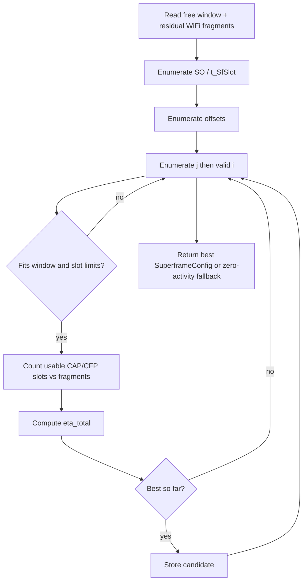
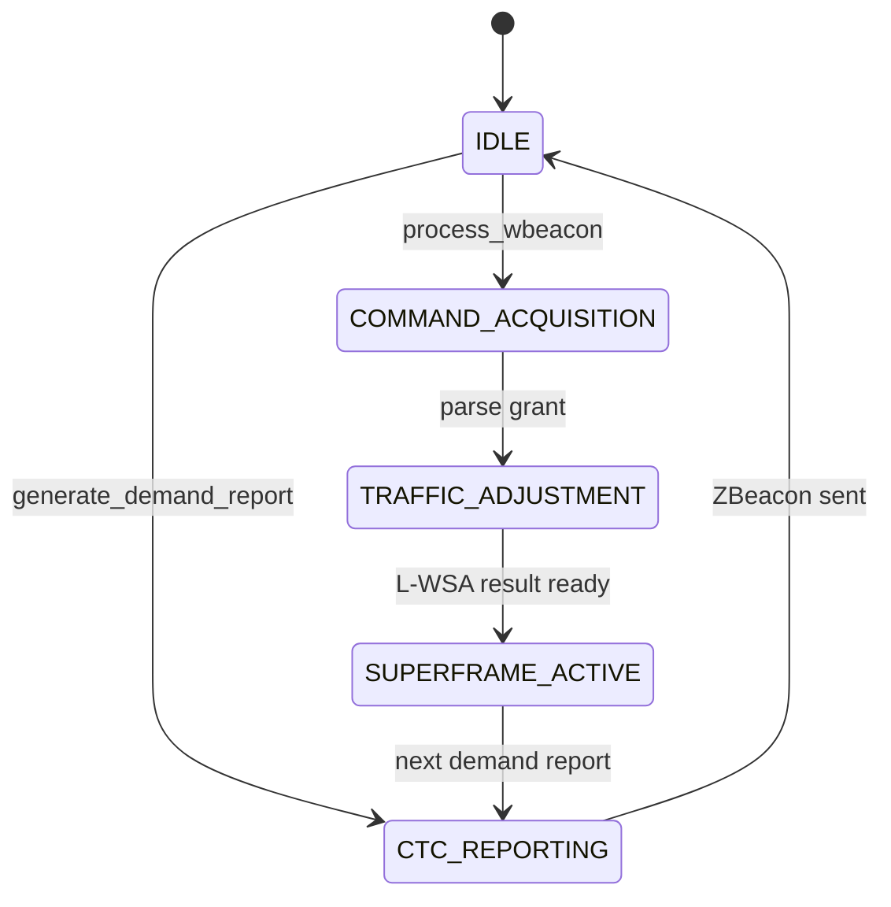

# Study Guide — Divyansh Saxena

**Presenter focus:** ZigBee side  
**Registration:** 24BCB0108  
**Use this guide to prepare your presentation section.** Write style: ASD-STE100.

---

## 1. Overview for the Presentation

You own the ZigBee domain. Explain how ZigBee uses the free window that WiFi grants. Cover:

- IEEE 802.15.4 beacon-enabled superframe
- L-WSA search (Algorithm 2)
- ZigBee Coordinator state machine
- ZBeacon demand reporting
- WBeacon processing and residual WiFi fragment avoidance

Upayan covers the shared loop and channel. Nitesh covers how WiFi creates the grant. Your job is to show how ZigBee turns that grant into an efficient superframe.

---

## 2. Quick Brief: Upayan's Architecture Work

The SimPy engine runs both sides on one timeline. CTC delivers ZBeacon and WBeacon as discrete-event messages with a configurable PER. The channel medium records overlaps and successes. Metrics such as $G_z$ and $PDR_w$ come from those records.

If asked how collisions are detected or how the engine schedules processes, hand off to Upayan.

---

## 3. Quick Brief: Nitesh's WiFi Work

The AP Orchestrator gathers ZigBee demand, solves a MILP (Equations 11–17), and emits a WBeacon with free and sensing window bounds. If MILP fails, whitespace fallback still tries to grant a safe gap.

Baselines Exp 1–3 exist for comparison. Exp 4 is full CoWiC-MAC.

If asked for MILP constraint details, hand off to Nitesh after stating the goal: move WiFi FGs to create protected ZigBee airtime without WiFi drops.

---

## 4. Deep Dive: ZigBee Domain

### 4.1 IEEE 802.15.4 superframe structure

A beacon-enabled superframe contains:

1. One beacon slot
2. $i$ CAP slots (nodes contend with CSMA/CA)
3. $j$ CFP slots (guaranteed time slots)

Hard limits used by L-WSA:

- $0 \le j \le 7$
- $i + j \le 15$
- Active length $= (1 + i + j) \cdot t_{\text{SfSlot}}$

Operational meaning:

- CAP is flexible and contention-based. A CAP slot is useful only if it can host a minimum packet exchange $t_{\min}$.
- CFP is scheduled. A CFP slot is useful if the full $t_{\text{SfSlot}}$ stays clear of residual WiFi.

PHY constants (2.4 GHz O-QPSK):

| Constant        | Value    |
| --------------- | -------- |
| Symbol duration | 0.016 ms |
| Base slot       | 0.96 ms  |
| Backoff slot    | 0.32 ms  |
| Turnaround      | 0.192 ms |
| ACK             | 0.352 ms |
| Max packet      | 4.256 ms (266 symbols including SHR and PHR) |

### 4.2 SuperframeConfig model

Module: `src/cowic/models/superframe.py`

| Field                | Meaning                                           |
| -------------------- | ------------------------------------------------- |
| `slot_duration_ms`   | $t_{\text{SfSlot}}$                               |
| `cap_slots`          | $i$                                               |
| `cfp_slots`          | $j$                                               |
| `beacon_offset_ms`   | Start offset of the beacon inside the free window |
| `beacon2_offset_ms`  | Start offset of Beacon2 at the active-period boundary |
| `beacon_interval_ms` | Superframe period / beacon interval               |

### 4.3 L-WSA search algorithm

Module: `src/cowic/zigbee/lwsa_adapter.py`

Objective:

```math
\eta_{\text{total}}
= m \cdot t_{\min} \cdot \eta_{\text{cap}}^{p}
+ \alpha \cdot n \cdot t_{\text{SfSlot}} \cdot \eta_{\text{cfp}}^{p}
```

Where:

- $m$ = clear CAP transmission opportunities counted at $t_{\min}$ stride
- $n$ = number of usable CFP slots after fragment filtering
- $\eta_{\text{cap}}^{p}$, $\eta_{\text{cfp}}^{p}$ = per-packet efficiency terms
- $\alpha$ = relative weight for CFP utility

Search domains:

| Variable              | Domain                                                                               |
| --------------------- | ------------------------------------------------------------------------------------ |
| Superframe order $SO$ | $[0, 14]$, $t_{\text{SfSlot}} = 0.96 \cdot 2^{SO}$ ms                                |
| CFP slots $j$         | $[0, 7]$                                                                             |
| CAP slots $i$         | all $i$ with $i + j \le 15$                                                          |
| Beacon offset         | free-window start, plus ends of residual WiFi fragments that start inside the window |



If no candidate fits, L-WSA returns a zero-activity config anchored at the window start. That is safer than claiming slots that collide.

### 4.4 ZigBee Coordinator state machine

Module: `src/cowic/zigbee/coordinator.py`



State meanings:

| State                 | Action                                  |
| --------------------- | --------------------------------------- |
| `IDLE`                | Waiting for demand report or WBeacon    |
| `CTC_REPORTING`       | Emit ZBeacon with `d_free_ms`           |
| `COMMAND_ACQUISITION` | Parse WBeacon window fields             |
| `TRAFFIC_ADJUSTMENT`  | Call L-WSA with residual WiFi fragments |
| `SUPERFRAME_ACTIVE`   | Use the chosen `SuperframeConfig`       |

### 4.5 ZBeacon demand reporting

`generate_demand_report(pending_packets) -> float` converts pending ZigBee work into requested airtime `d_free_ms`.

The AP reads that scalar through CTC. The AP does not receive a full packet queue. It receives a time demand.

### 4.6 WBeacon processing

`process_wbeacon(wbeacon, residual_wifi_fragments)` does three things:

1. Read free-window and sensing-window bounds from the WBeacon payload.
2. Keep residual WiFi fragments as a separate argument. The current CTC payload only carries scalar floats, so fragment lists are not packed into the WBeacon body.
3. Call L-WSA and return a `SuperframeConfig`.

This matches the base-paper Algorithm 2 idea that the ZC also senses residual WiFi activity inside the granted window.

### 4.7 Residual WiFi fragments

Why they exist:

- Some WiFi FGs cannot move because of deadlines or carryover.
- The free window is therefore not always one clean gap.
- ZigBee must place beacon / CAP / CFP slots around the leftovers.

How L-WSA handles them:

- Candidate offsets include fragment boundaries.
- CAP usefulness uses $t_{\min}$ occupancy checks.
- CFP usefulness uses full-slot occupancy checks.
- Slots that hit a fragment do not add to $m$ or $n$.

---

## 5. Likely Questions and Answers

**Q1. Why adapt the superframe at all?**  
A. A fixed ZigBee layout wastes fragmented whitespace. L-WSA reshapes slot size and counts to the granted geometry.

**Q2. Why is $j$ capped at 7?**  
A. That limit comes from the IEEE 802.15.4 / CoWiC-MAC formulation used in this project. CAP + CFP also cannot exceed 15 active data slots beyond the beacon accounting used here.

**Q3. What is** $t_{\min}$?  
A. The minimum time needed for a CAP packet exchange, including backoff and ACK overhead.

**Q4. What if the free window is too short?**  
A. L-WSA returns a zero-activity configuration. ZigBee does not invent slots that cannot fit.

**Q5. Why pass residual fragments separately from the WBeacon?**  
A. The CTC payload schema stores scalar floats. Fragment lists stay outside that schema and follow the ZC's local sensing model.

**Q6. How does ZigBee know when to talk?**  
A. The WBeacon gives absolute free-window bounds. The ZC places its beacon at `beacon_offset_ms` inside that window.

**Q7. CAP vs CFP in one sentence?**  
A. CAP is contended access. CFP is reserved access.

**Q8. How does your work prove L-WSA matters?**  
A. Ablation Exp 5 keeps ZigBee fixed under hard WiFi vacate. Comparing Exp 4 against that isolation shows the value of adaptive superframes under fragmentation.

**Q9. Which files should a reviewer open for your domain?**  
A. `lwsa_adapter.py`, `coordinator.py`, `models/superframe.py`, and `tests/test_lwsa_algorithm.py`.

**Q10. What should the audience remember from your section?**  
A. ZigBee does not wait for perfect white space. It reshapes its superframe to the exact gap WiFi can give.
