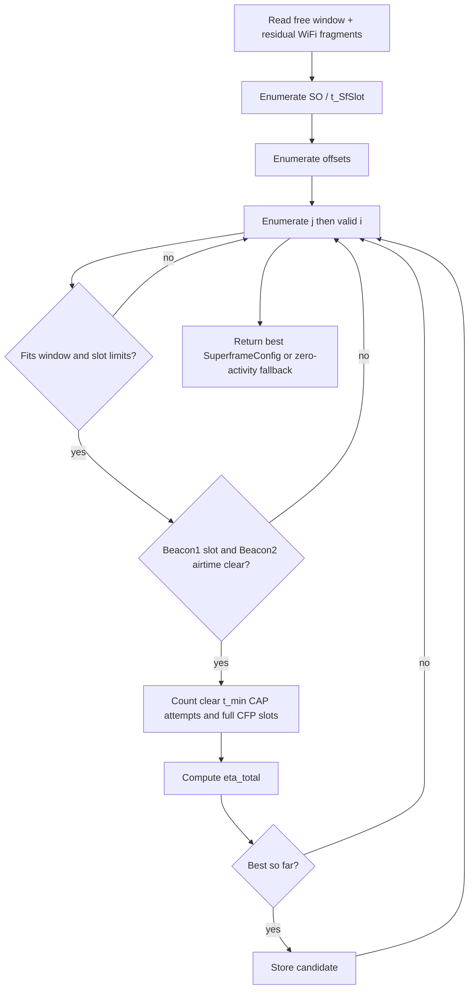
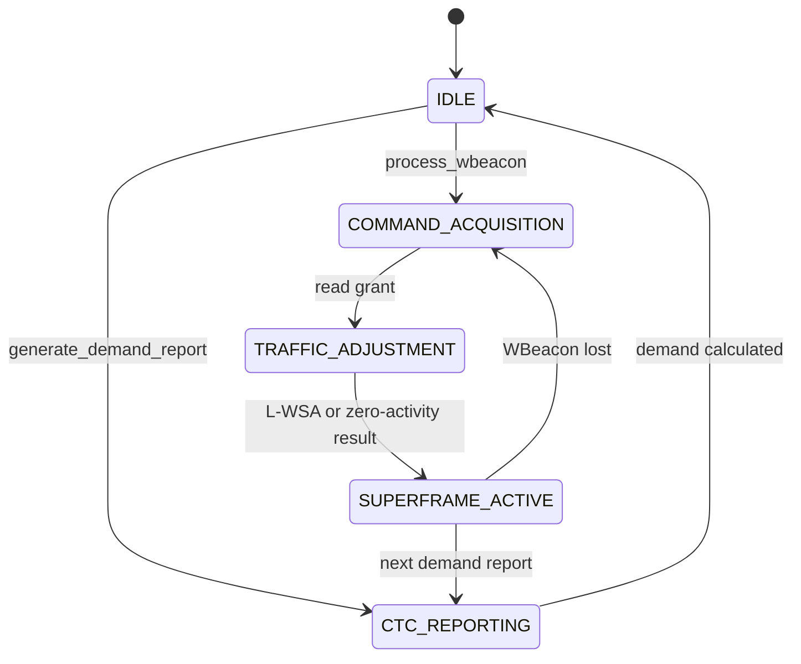

# Study Guide — Divyansh Saxena

**Presenter focus:** ZigBee side  
**Registration:** 24BCB0108  
Use this guide to prepare your presentation section.

---

## 1. Overview for the Presentation

You own the ZigBee domain. Explain how the coordinator fits a superframe into the AP's free window. Cover:

- IEEE 802.15.4 beacon-enabled superframe and the split Beacon1/Beacon2 design
- L-WSA search (Algorithm 2), including clear CAP attempts and beacon checks
- ZigBee Coordinator state transitions and ZBeacon demand
- WBeacon processing and avoidance of residual WiFi fragments

Upayan covers the shared loop and channel. Nitesh covers how WiFi creates the grant. Show the difference between the paper's radio protocol and this software simulation.

---

## 2. Quick Brief: Upayan's Architecture Work

The SimPy engine runs both sides on one timeline. CTC models control messages with delay and a packet error rate. It does not emulate WiCast or SymBee waveforms. The medium marks overlapping transmissions as failed. Metrics such as $G_z$ and $PDR_w$ come from those records.

If asked how collisions are detected or how the engine schedules processes, hand off to Upayan.

---

## 3. Quick Brief: Nitesh's WiFi Work

The AP Orchestrator reads ZigBee demand, schedules WiFi frame groups (FGs) with a MILP, and sends a WBeacon with free-window and sensing-window bounds. If the solver gives no usable schedule, the fallback searches for a gap.

Exp 1–3 are baselines. Exp 4 uses a soft free-window constraint and L-WSA. Exp 5 uses a hard free-window constraint and a fixed ZigBee superframe. Do not say that Exp 4 loses no WiFi traffic on Traffic I.

---

## 4. Deep Dive: ZigBee Domain

### 4.1 IEEE 802.15.4 superframe structure

A beacon-enabled superframe has up to 16 equal slots:

1. An initial slot for Beacon1.
2. $i$ contention access period (CAP) slots for slotted CSMA/CA.
3. $j$ contention-free period (CFP) slots for guaranteed time slots (GTS).

In this implementation, Beacon2 starts at the boundary after the Beacon1 slot. It announces the slot allocation. Its 0.48 ms airtime shares the start of the next slot rather than adding a 17th slot.

L-WSA uses these limits:

- $0 \le j \le 7$
- $i + j \le 15$
- Active length $= (1 + i + j) \cdot t_{\text{SfSlot}}$

CAP attempts use a $t_{\min}$ grid across the full CAP region, not one attempt per CAP slot. CFP checks each full slot against residual WiFi. The solver requires the Beacon1 slot and the Beacon2 airtime to be free of residual WiFi.

PHY constants (2.4 GHz O-QPSK):

| Constant        | Value    |
| --------------- | -------- |
| Symbol duration | 0.016 ms |
| Base slot       | 0.96 ms  |
| Backoff slot    | 0.32 ms  |
| Turnaround      | 0.192 ms |
| ACK             | 0.352 ms |
| Max packet      | 4.256 ms (266 symbols including SHR and PHR) |

### 4.2 SuperframeConfig model

Module: `src/cowic/models/superframe.py`

| Field                | Meaning                                           |
| -------------------- | ------------------------------------------------- |
| `slot_duration_ms`   | $t_{\text{SfSlot}}$                               |
| `cap_slots`          | $i$                                               |
| `cfp_slots`          | $j$                                               |
| `beacon_offset_ms`   | Start of Beacon1 inside the free window           |
| `beacon2_offset_ms`  | Start of Beacon2 one slot after Beacon1, or `None` for an inactive L-WSA result |
| `beacon_interval_ms` | Configured interval; L-WSA sets it to free-window length |

### 4.3 L-WSA search algorithm

Module: `src/cowic/zigbee/lwsa_adapter.py`

Objective:

```math
\eta_{\text{total}}
= m \cdot t_{\min} \cdot \eta_{\text{cap}}^{p}
+ \alpha \cdot n \cdot t_{\text{SfSlot}} \cdot \eta_{\text{cfp}}^{p}
```

Where:

- $m$ = clear $t_{\min}$-spaced CAP attempts across the CAP region
- $n$ = CFP slots whose entire slot does not overlap a residual WiFi fragment
- $\eta_{\text{cap}}^{p}$, $\eta_{\text{cfp}}^{p}$ = per-packet efficiency terms
- $\alpha$ = relative weight for CFP utility

Search domains:

| Variable              | Domain                                                                               |
| --------------------- | ------------------------------------------------------------------------------------ |
| Superframe order $SO$ | $[0, 14]$, $t_{\text{SfSlot}} = 0.96 \cdot 2^{SO}$ ms                                |
| CFP slots $j$         | $[0, 7]$                                                                             |
| CAP slots $i$         | all $i$ with $i + j \le 15$                                                          |
| Beacon offset         | free-window start, plus the ends of residual WiFi fragments that overlap and end inside the window |



If no positive-utility candidate fits, L-WSA returns a zero-activity config anchored at the window start. It does not create data slots that cannot fit.

### 4.4 ZigBee Coordinator state machine

Module: `src/cowic/zigbee/coordinator.py`



The diagram shows the main states, not every call path. `generate_demand_report` returns to `IDLE` from any current state. `process_wbeacon` reads the payload before setting `COMMAND_ACQUISITION`; a malformed payload raises an error without these transitions.

| State                 | Action |
| --------------------- | ------ |
| `IDLE`                | Initial state or return after demand calculation |
| `CTC_REPORTING`       | Calculate `d_free_ms` for the ZBeacon |
| `COMMAND_ACQUISITION` | Accept a valid WBeacon, or wait after a lost one |
| `TRAFFIC_ADJUSTMENT`  | Call L-WSA with residual WiFi fragments if the grant has positive length |
| `SUPERFRAME_ACTIVE`   | Store the chosen `SuperframeConfig`, including an inactive result for an empty grant |

### 4.5 ZBeacon demand reporting

`generate_demand_report(pending_packets, demand_limit_ms=None) -> float` multiplies the queue count by two backoff slots plus the intended packet duration. The optional limit caps synthetic demand to the configured free-window size. `build_zbeacon` puts this `d_free_ms` scalar into a CTC message. The AP does not receive the queue.

### 4.6 WBeacon processing

`process_wbeacon(wbeacon, residual_wifi_fragments)` reads the granted free-window bounds and calls L-WSA for a positive-length grant. An empty grant yields a zero-activity config without calling L-WSA. The WBeacon payload also has sensing-window bounds, but this method does not use them to place the superframe.

Fragment intervals are a separate argument, not a WBeacon field. In the simulation, the engine derives them from scheduled WiFi FGs that overlap the grant. This models the ZC's local sensing in the paper. It does not implement physical ZigBee sensing.

### 4.7 Residual WiFi fragments

- Some WiFi FGs remain in the granted window because the AP uses a soft free-window constraint.
- The simulation clips their scheduled airtime to the window and passes those intervals to the ZC.
- L-WSA tries offsets at the window start and at fragment ends inside the window.
- It rejects a candidate if WiFi overlaps the full Beacon1 slot or Beacon2's 0.48 ms airtime.
- It counts clear $t_{\min}$-spaced CAP intervals, not CAP slots. It counts only CFP slots that are entirely clear.

The simulation emits Beacon1 before Beacon2, then places CAP attempts after two backoff slots on the $t_{\min}$ grid. A CAP packet overlapping sensed WiFi is deferred. For CFP, the simulation defers packets overlapping sensed WiFi. It does not move a deferred packet to an earlier slot. The medium still checks each emitted packet against actual WiFi airtime.

### 4.8 Results to present

The reference sweep uses synthetic Traffic I (88% WiFi occupancy), 60 s runs, seed 42, and $T_{\text{ZB}}=1000$ ms. These are simulation results, not physical ZigBee measurements or a full reproduction of the paper's 600 s runs.

| Scheme and metric | $D_{\text{free}}=31$ ms | 62 ms | 123 ms |
| --- | ---: | ---: | ---: |
| Exp 4, adaptive, $G_z$ | 0.94 | 0.87 | 0.63 |
| Exp 4, WiFi drop rate | 1.3% | 2.7% | 4.0% |
| Exp 5, fixed with hard vacate, $G_z$ | 1.00 | 1.00 | 1.00 |
| Exp 5, WiFi drop rate | 1.3% | 3.4% | 8.1% |

$G_z$ compares delivered ZigBee payload with the clean-window payload for the same demand. It is not a physical-radio packet delivery ratio. Exp 5 clears the whole window for its fixed superframe, but drops more WiFi at longer windows. Exp 4 allows residual WiFi and has lower $G_z$ on busy Traffic I. The WiFi rule, sensing window, CTC direction, and ZigBee layout all differ. Thus this comparison does not isolate L-WSA.

---

## 5. Likely Questions and Answers

**Q1. Why adapt the superframe at all?**  
A. A fixed ZigBee layout wastes fragmented whitespace. L-WSA reshapes slot size and counts to the granted geometry.

**Q2. Why is $j$ capped at 7?**  
A. That limit comes from the IEEE 802.15.4 / CoWiC-MAC formulation used in this project. CAP + CFP also cannot exceed 15 active data slots beyond the beacon accounting used here.

**Q3. What is** $t_{\min}$?  
A. It is two backoff slots plus the chosen packet duration. The code caps that packet duration by the slot and PHY maximum, after allowance for turnaround and ACK.

**Q4. What if the free window is too short?**  
A. L-WSA returns a zero-activity configuration if it finds no positive-utility candidate. An empty WBeacon grant also gives an inactive configuration.

**Q5. Why pass residual fragments separately from the WBeacon?**  
A. The message contains scalar window bounds, not a fragment list. The engine derives residual intervals from the WiFi schedule to model ZC sensing.

**Q6. How does ZigBee know when to talk?**  
A. In the paper, WBeacon 1 announces timing for sensing. The ZC sends a ZBeacon there. WBeacon 2 announces the grant. The simulation represents the demand and grant messages, but it does not transmit a separate WBeacon 1. L-WSA places Beacon1 inside the granted window and Beacon2 one slot later.

**Q7. CAP vs CFP in one sentence?**  
A. CAP is contended access. CFP is reserved access.

**Q8. How does Exp 5 compare with Exp 4?**<br>
A. Exp 5 uses a fixed ZigBee layout and forces WiFi to vacate the window. It achieves $G_z=1.00$ at all three window sizes in the 60 s Traffic I run. At 123 ms, it drops 8.1% of WiFi airtime. Exp 4 adapts the layout and allows residual WiFi. At 31, 62, and 123 ms, its $G_z$ is 0.94, 0.87, and 0.63. Its WiFi drop rates are 1.3%, 2.7%, and 4.0%. The WiFi rule, sensing window, and CTC direction also differ, so this comparison does not isolate L-WSA.

**Q9. Which files should a reviewer open for your domain?**  
A. `src/cowic/zigbee/lwsa_adapter.py`, `src/cowic/zigbee/coordinator.py`, `src/cowic/models/superframe.py`, `src/cowic/sim/simulation_engine.py`, and `tests/test_lwsa_algorithm.py`.

**Q10. What should the audience remember from your section?**  
A. L-WSA fits the superframe to a granted window and avoids modeled WiFi fragments. This software simulation is not a physical ZigBee implementation.
