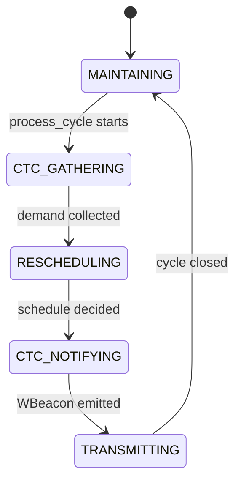
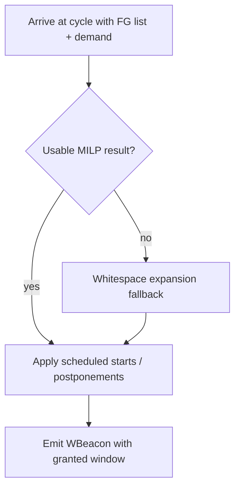

# Study Guide — Nitesh Pandey

**Presenter focus:** WiFi side  
**Registration:** 24BCB0141  
Use this guide to prepare your presentation section.

---

## 1. Overview for the Presentation

You own the WiFi domain. Explain how the AP schedules airtime for ZigBee while limiting, but not eliminating, WiFi loss. Cover:

- Frame Group model
- MILP scheduler (Equations 11–17)
- AP orchestrator state machine
- Fallback whitespace expansion
- Baseline Exp 1 / Exp 2 / Exp 3
- Synthetic traffic generation

Upayan covers the overall loop and channel. Divyansh covers ZigBee adaptation. Your job is to show the WiFi decision engine.

---

## 2. Quick Brief: Upayan's Architecture Work

The simulation engine runs AP and ZC processes in one SimPy environment. CTC carries ZBeacon demand and WBeacon grants. The shared channel medium detects temporal overlaps and feeds metrics.

Key metrics: $G_z$ (delivered ZigBee payload relative to clean-window demand), $PDR_w$ (WiFi airtime lost to deadlines or collisions), $U_{\text{eff}}$, jitter, and maximum delay.

If asked about collision detection or the SimPy event loop, hand off to Upayan after one sentence.

---

## 3. Quick Brief: Divyansh's ZigBee Work

After the AP grants a free window, the ZigBee Coordinator runs L-WSA. L-WSA chooses slot duration, CAP/CFP counts, and beacon offset so the superframe fits inside the grant and avoids residual WiFi fragments.

Hard limits: $j \le 7$, $i + j \le 15$. ZC states move from demand reporting to command acquisition to traffic adjustment to an active superframe.

If asked for L-WSA enumeration details, hand off to Divyansh.

---

## 4. Deep Dive: WiFi Domain

### 4.1 Frame Group model

Module: `src/cowic/models/frame_group.py`

A Frame Group is the AP scheduling unit. It matches the 802.11ax idea of batching frames under TWT / trigger-frame control.

Important fields:

| Field               | Role                       |
| ------------------- | -------------------------- |
| `fg_id`             | Identity                   |
| `arrival_time_ms`   | Causality lower bound      |
| `duration_ms`       | Airtime $d_k$              |
| `deadline_ms`       | Latest finish $e_k$        |
| `original_start_ms` | Pre-reschedule start $s_k$ |
| `qos_sensitive`     | Delay priority hint        |

### 4.2 MILP scheduler

Module: `src/cowic/wifi/milp_scheduler.py`

The Exp 4 objective is:

```math
\min \sum_k z_k^{\text{free}}d_k
+ \gamma\sum_k z_k^{\text{sense}}d_k
+ \lambda\sum_k y_k
+ \sum_k \mu_k P_k
+ C_{\text{drop}}\sum_k D_k
```

Here $z_k$ flags an FG that overlaps a window. The model charges its full duration $d_k$, not the exact overlap duration. Sensing has zero overlap cost in a feasible schedule because a hard constraint forbids overlap. For an FG sent this cycle, $y_k$ measures $|s'_k-s_k|$, including earlier and later moves. A postponed FG has no deviation cost. $P_k=1$ postpones it. Its deadline-aware cost is $\mu_k=\mu_{\text{base}}/\max(\epsilon,e_k-(T_{\text{end}}+d_k))$. $D_k=1$ marks a postponed FG that cannot meet its deadline. The drop penalty $C_{\text{drop}}$ exceeds all other objective costs together. We use $\gamma=10$, $\lambda=1$, and $\mu_{\text{base}}=100$. The paper does not give these weights.

Constraint groups:

1. **Window placement** — free and sensing windows fit within the cycle and do not overlap.
2. **Deviation** — for an FG sent now, $y_k\ge s'_k-s_k$ and $y_k\ge s_k-s'_k$.
3. **Causality and deadlines** — an FG sent now starts after arrival and ends before its deadline. A trace FG already crossing the cycle boundary may keep its original end time.
4. **Postponement and drops** — kept postponed FGs must meet their deadlines together in earliest-deadline-first order. An FG that cannot be kept may be marked dropped.
5. **Inter-FG non-overlap** — ordering binaries and Big-M prevent two FGs sent this cycle from occupying the same time.
6. **Window overlap** — a side-selecting binary places each non-overlapping FG before or after each window. Free-window overlap has a cost, not a ban.
7. **Sensing protection** — $\sum_k z_k^{\text{sense}}=0$. No FG sent this cycle may occupy the sensing window.

Solver path: PuLP → HiGHS with a 10 s limit per cycle. The solver can return a feasible but unproved `Integer Feasible` schedule at this limit. The AP rejects an unproved schedule with drops. The AP uses fallback when it receives no usable result. A proven optimum can still drop an FG if no feasible schedule can serve it now or in the next cycle.

Postponed FG reporting convention: `scheduled_start_ms = t_end_ms` and `delay_ms = max(0, t_end_ms - original_start_ms)`. This is a reporting position, not a promise of delivery.

### 4.3 AP orchestrator state machine

Module: `src/cowic/wifi/ap_orchestrator.py`



What each state does:

| State           | Work                         |
| --------------- | ---------------------------- |
| `MAINTAINING`   | Ready for next cycle         |
| `CTC_GATHERING` | Read ZBeacon demand          |
| `RESCHEDULING`  | Call MILP or fallback        |
| `CTC_NOTIFYING` | Build and send WBeacon       |
| `TRANSMITTING`  | Apply the chosen FG schedule |

On error, the orchestrator restores `MAINTAINING` before it re-raises.

### 4.4 Fallback whitespace expansion

Module: `src/cowic/wifi/fallback.py`

Trigger: the AP has no scheduler, the solver raises a handled error, or its status is not accepted. This includes an unproved incumbent with drops.

Behaviour:

1. Search for the earliest natural gap that fits sensing plus the requested free window without new postponements.
2. Otherwise extend the largest gap as far as feasible. Shorten the free window if the full request would cause new postponements.
3. Respect `channel_free_at` so carryover WiFi cannot be treated as idle airtime.
4. Reserve the sensing interval even if that forces postponements. If the remaining cycle cannot hold sensing, grant no window.

The no-new-postponement rule applies to the optional free portion, relative to carryover-only or sensing-only deferral. Carryover or mandatory sensing can still postpone an FG. Fallback does not guarantee the requested free duration, zero drops, or optimality.

### 4.5 Baseline schedulers

Module: `src/cowic/wifi/baselines.py`

| Exp   | Scheduler intent                                                                         |
| ----- | ---------------------------------------------------------------------------------------- |
| Exp 1 | Uncoordinated: keep original WiFi timing and grant no ZigBee window.                     |
| Exp 2 | Opportunistic: announce the largest natural gap, capped by demand. Do not move WiFi.     |
| Exp 3 | ECC: reserve a fixed cycle-start NAV window of at most 40 ms and defer overlapping WiFi. |

Exp 3 suppresses its reservation if WiFi carryover already occupies the cycle start. None of these baselines reserves a sensing window.

### 4.6 Synthetic traffic generator

Modules: `traces/synthetic_generator.py`, `traces/playback.py`

- Generates FG arrivals that follow Table 5 traffic profiles
- Traffic I is high load. Traffic III is lighter. Traffic II and IV fill the full occupancy range.
- Playback loads a trace and splits it into scheduling cycles. The sweep runner caches traces by profile, duration, and seed for reproducible sweeps.

### 4.7 Measured Exp 4 trade-off

The Review 3 reference run uses 60 s synthetic Traffic I traces at 88% WiFi occupancy. It uses $T_{ZB}=1000$ ms and a 10 ms sensing window. These are simulation results, not the paper's measurements.

| $D_{\text{free}}$ | 31 ms | 62 ms | 123 ms |
| --- | ---: | ---: | ---: |
| $G_z$ | 0.94 | 0.87 | 0.63 |
| $PDR_w$ | 1.3% | 2.7% | 4.0% |

As the request grows, WiFi loss rises and ZigBee receives a smaller share of its demand on this trace. At 123 ms, 88% occupancy plus 123 ms free and 10 ms sensing airtime needs about 101% of a 1000 ms cycle. Do not promise full ZigBee service and zero WiFi loss together. The paper reports zero WiFi loss for Exp 4, but this run does not reproduce it. The solver stopped at its 10 s limit in 432 cycles of the reference run. Some values thus depend on the machine.

### 4.8 MILP decision flow



---

## 5. Likely Questions and Answers

**Q1. Why MILP instead of a greedy deferral rule?**  
A. The AP must jointly place a free window, protect sensing, keep deadlines, and avoid FG overlap. MILP encodes all of that in one programme.

**Q2. What does Big-M do here?**  
A. It turns logical either/or ordering into linear inequalities. One FG is fully before another, or fully after it.

**Q3. Why is sensing protection hard, not soft?**  
A. The ZC needs a reliable uplink slot to report demand. Soft protection would let WiFi erase that slot.

**Q4. When do you postpone or drop an FG?**<br>
A. The solver can postpone an FG only if the kept postponed set can meet deadlines in the next cycle. It can mark an FG dropped at a high cost when keeping it is infeasible. A time-limited incumbent with drops is not accepted as proof that they are necessary.

**Q5. Does Exp 4 avoid all WiFi drops?**<br>
A. No. In the 60 s Traffic I reference run, $PDR_w$ is 1.3%, 2.7%, and 4.0% at $D_{\text{free}}=31$, 62, and 123 ms. The paper reports zero. This difference reflects the busy synthetic trace, weights the paper does not specify, and a 10 s solve limit.

**Q6. What is the difference between Exp 2 and Exp 4?**  
A. Exp 2 only uses natural gaps. Exp 4 actively reshapes WiFi airtime with MILP.

**Q7. Why do you need fallback if you already have MILP?**  
A. The AP uses fallback when it has no usable solver result. It protects sensing if possible, but may shorten the free window and cannot guarantee zero WiFi loss.

**Q8. What does `channel_free_at` protect against?**  
A. Carryover WiFi from the previous cycle that still occupies the start of the new cycle.

**Q9. Which CLI runs your benchmarks?**  
A. `python scripts/run_benchmark_sweep.py` with optional `--quick` and `--traffic`.

**Q10. What should the audience remember from your section?**  
A. The AP chooses window positions and moves WiFi FGs. Sensing is mandatory. The free window is a trade-off: our busy-trace results gain ZigBee delivery but do not eliminate WiFi drops.
