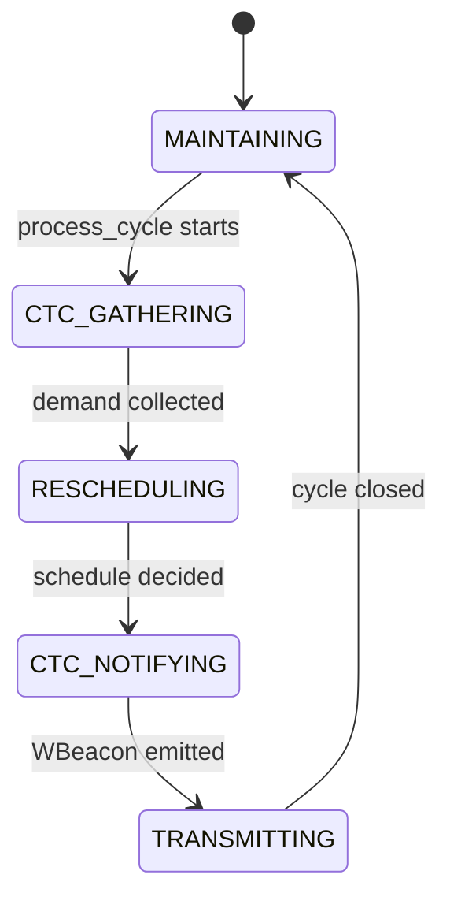
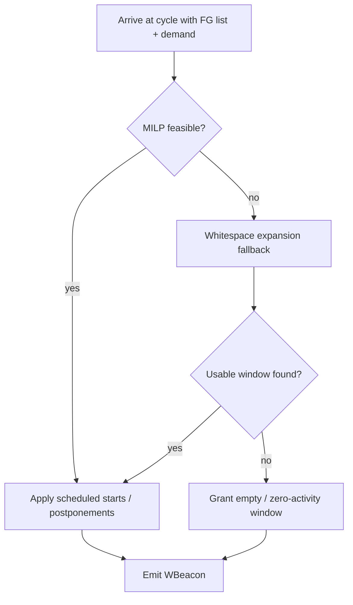

# Study Guide — Nitesh Pandey

**Presenter focus:** WiFi side  
**Registration:** 24BCB0141  
**Use this guide to prepare your presentation section.** Write style: ASD-STE100.

---

## 1. Overview for the Presentation

You own the WiFi domain. Explain how WiFi creates safe airtime for ZigBee without dropping its own Frame Groups. Cover:

- Frame Group model
- MILP scheduler (Equations 11–17)
- AP orchestrator state machine
- Fallback whitespace expansion
- Baseline Exp 1 / Exp 2 / Exp 3
- Synthetic traffic generation

Upayan covers the overall loop and channel. Divyansh covers ZigBee adaptation. Your job is to show the WiFi decision engine.

---

## 2. Quick Brief: Upayan's Architecture Work

The simulation engine runs AP and ZC processes in one SimPy environment. CTC carries ZBeacon demand and WBeacon grants. The shared channel medium detects temporal overlaps and feeds metrics.

Key metrics: $G_z$ (ZigBee gain), $PDR_w$ (WiFi drop rate), $U_{\text{eff}}$, jitter, max delay.

If asked about collision detection or the SimPy event loop, hand off to Upayan after one sentence.

---

## 3. Quick Brief: Divyansh's ZigBee Work

After the AP grants a free window, the ZigBee Coordinator runs L-WSA. L-WSA chooses slot duration, CAP/CFP counts, and beacon offset so the superframe fits inside the grant and avoids residual WiFi fragments.

Hard limits: $j \le 7$, $i + j \le 15$. ZC states move from demand reporting to command acquisition to traffic adjustment to an active superframe.

If asked for L-WSA enumeration details, hand off to Divyansh.

---

## 4. Deep Dive: WiFi Domain

### 4.1 Frame Group model

Module: `src/cowic/models/frame_group.py`

A Frame Group is the AP scheduling unit. It matches the 802.11ax idea of batching frames under TWT / trigger-frame control.

Important fields:

| Field               | Role                       |
| ------------------- | -------------------------- |
| `fg_id`             | Identity                   |
| `arrival_time_ms`   | Causality lower bound      |
| `duration_ms`       | Airtime $d_k$              |
| `deadline_ms`       | Latest finish $e_k$        |
| `original_start_ms` | Pre-reschedule start $s_k$ |
| `qos_sensitive`     | Delay priority hint        |

### 4.2 MILP scheduler

Module: `src/cowic/wifi/milp_scheduler.py`

Objective:

```math
\min \sum_k z_k^{\text{free}} d_k
+ \gamma \sum_k z_k^{\text{sense}} d_k
+ \lambda \sum_k y_k
+ \sum_k \mu_k P_k
```

Interpretation:

- Pay for WiFi airtime that overlaps the free window
- Pay more for overlap of the sensing window
- Pay for delay $y_k$
- Pay for postponement $P_k$

Constraint groups:

1. **Delay definition** — $y_k \ge s'_k - s_k$, $y_k \ge 0$
2. **Causality** — FG cannot start before arrival unless postponed
3. **Deadline / cycle bound** — FG must finish by deadline and by cycle end, unless postponed
4. **Postponed feasibility** — a postponed FG must still fit after $T_{\text{end}}$ before its deadline
5. **Inter-FG non-overlap** — ordering binaries $b_{kj}$ and Big-M stop two FGs from occupying the same time
6. **Overlap indicators** — $z_k$ variables mark intersection with free / sensing windows
7. **Sensing protection** — $\sum_k z_k^{\text{sense}} = 0$

Solver path: PuLP model → HiGHS (`highspy`). Non-optimal / infeasible status maps to a no-solution result. The AP then calls fallback.

Postponed FG reporting convention used across the codebase: report `scheduled_start_ms = t_end_ms` and `delay_ms = max(0, t_end_ms - original_start_ms)`.

### 4.3 AP orchestrator state machine

Module: `src/cowic/wifi/ap_orchestrator.py`



What each state does:

| State           | Work                         |
| --------------- | ---------------------------- |
| `MAINTAINING`   | Ready for next cycle         |
| `CTC_GATHERING` | Read ZBeacon demand          |
| `RESCHEDULING`  | Call MILP or fallback        |
| `CTC_NOTIFYING` | Build and send WBeacon       |
| `TRANSMITTING`  | Apply the chosen FG schedule |

On error, the orchestrator restores `MAINTAINING` before it re-raises.

### 4.4 Fallback whitespace expansion

Module: `src/cowic/wifi/fallback.py`

Trigger: MILP returns no usable solution.

Behaviour:

1. Find natural whitespace gaps among pending FGs.
2. Prefer a gap that already fits the requested free duration.
3. Else expand the largest gap by deferring nearby FGs.
4. Use `channel_free_at` so carryover airtime from the previous cycle is respected.
5. Never introduce an avoidable postponement that the baseline would not already force.

This is a lightweight heuristic. It does not claim optimality.

### 4.5 Baseline schedulers

Module: `src/cowic/wifi/baselines.py`

| Exp   | Scheduler intent                                                      |
| ----- | --------------------------------------------------------------------- |
| Exp 1 | Static / uncoordinated. Keep original FG times.                       |
| Exp 2 | Opportunistic. Notify ZigBee about natural gaps. Do not move WiFi.    |
| Exp 3 | ECC. Reserve with NAV-style protection. Keep ZigBee superframe fixed. |

These baselines exist so Exp 4 gains are measured against real alternatives, not against an empty strawman.

### 4.6 Synthetic traffic generator

Modules: `traces/synthetic_generator.py`, `traces/playback.py`

- Generates FG arrivals that follow Table 5 traffic profiles
- Traffic I is high load. Traffic III is lighter. Traffic II and IV fill the full occupancy range.
- Playback loads a trace and splits it into scheduling cycles. The sweep runner caches traces by profile, duration, and seed for reproducible sweeps.

### 4.7 MILP decision flow



---

## 5. Likely Questions and Answers

**Q1. Why MILP instead of a greedy deferral rule?**  
A. The AP must jointly place a free window, protect sensing, keep deadlines, and avoid FG overlap. MILP encodes all of that in one programme.

**Q2. What does Big-M do here?**  
A. It turns logical either/or ordering into linear inequalities. One FG is fully before another, or fully after it.

**Q3. Why is sensing protection hard, not soft?**  
A. The ZC needs a reliable uplink slot to report demand. Soft protection would let WiFi erase that slot.

**Q4. When do you postpone an FG?**  
A. When keeping it in the current cycle would violate deadlines or destroy the required windows. Postponement is preferred over a drop when the next cycle can still meet the deadline.

**Q5. How does the model avoid WiFi drops?**  
A. The model prefers delay and postponement costs over discarding airtime. A drop occurs only when no feasible keep-or-postpone option remains. At the documented acceptance point (Exp 4, $D_{\text{free}}=31$ ms, $T_{ZB}=1000$ ms), $PDR_w = 0$.

**Q6. What is the difference between Exp 2 and Exp 4?**  
A. Exp 2 only uses natural gaps. Exp 4 actively reshapes WiFi airtime with MILP.

**Q7. Why do you need fallback if you already have MILP?**  
A. Some cycles are infeasible under current arrivals and carryover. Fallback still tries to grant ZigBee something safe.

**Q8. What does `channel_free_at` protect against?**  
A. Carryover WiFi from the previous cycle that still occupies the start of the new cycle.

**Q9. Which CLI runs your benchmarks?**  
A. `python scripts/run_benchmark_sweep.py` with optional `--quick` and `--traffic`.

**Q10. What should the audience remember from your section?**  
A. WiFi is the active coordinator: it solves for windows, protects sensing, and only then tells ZigBee where it may transmit.
