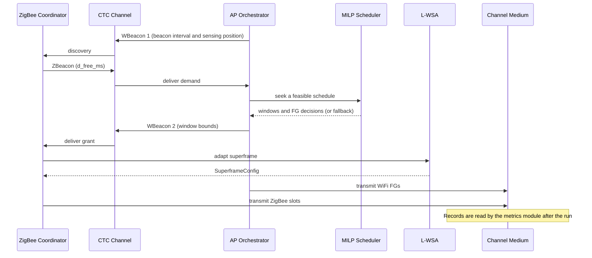
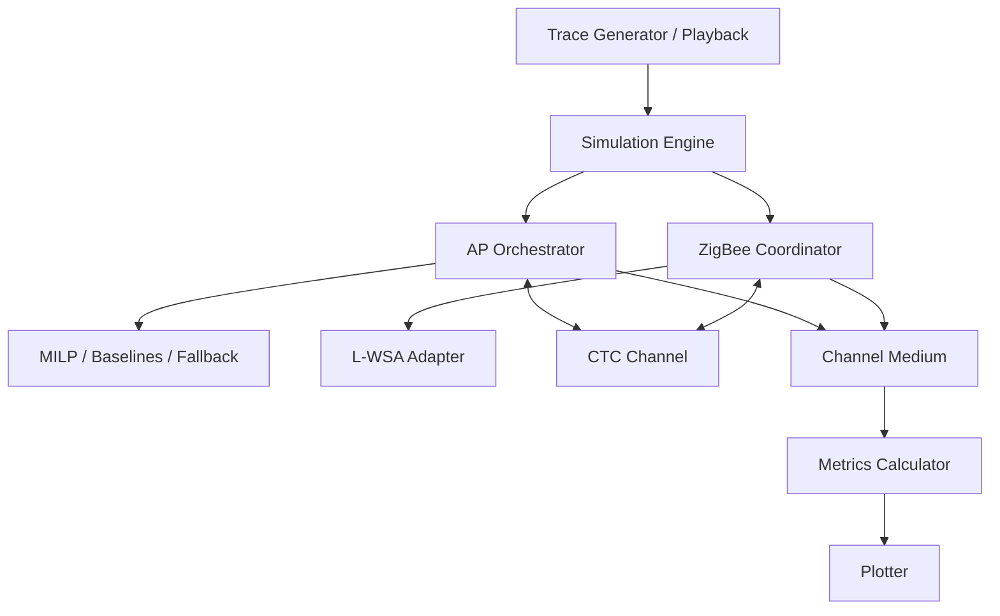

# Study Guide — Upayan Mazumder

**Presenter focus:** Central architecture  
**Registration:** 24BDS0367  
Use this guide to prepare your presentation section.

---

## 1. Overview for the Presentation

You own the central architecture. Explain how the whole system works as one closed loop. Cover:

- System model and data flow
- CTC link (WBeacon / ZBeacon)
- SimPy simulation engine
- Shared 2.4 GHz channel medium
- Metrics that close the evaluation loop

Nitesh covers WiFi internals. Divyansh covers ZigBee internals. Your job is to join both sides and show the shared machinery.

---

## 2. Quick Brief: Nitesh's WiFi Work

A Frame Group (FG) is a WiFi batch with an arrival time, duration, and deadline. The AP cycles through `MAINTAINING → CTC_GATHERING → RESCHEDULING → CTC_NOTIFYING → TRANSMITTING`.

In `RESCHEDULING`, the MILP tries to place a free window and a protected sensing window. It may leave WiFi fragments in the free window. The solver has a 10-second cycle limit. The AP uses whitespace expansion when the solver has no usable result.

Baselines:

- Exp 1: no coordination
- Exp 2: opportunistic idle-gap sensing
- Exp 3: ECC / NAV reservation with a fixed ZigBee superframe

If asked for MILP details, ask Nitesh to explain overlap, absolute movement, postponement, and deadline costs.

---

## 3. Quick Brief: Divyansh's ZigBee Work

The ZigBee Coordinator (ZC) reports demand with a ZBeacon. After it receives a WBeacon, it runs L-WSA.

L-WSA searches over slot duration $t_{\text{SfSlot}}$, CAP slots $i$, CFP slots $j$, and beacon offset $t_{\text{offset}}$. Hard limits: $j \le 7$ and $i + j \le 15$. The search maximises usable CAP and CFP efficiency while avoiding residual WiFi fragments.

ZC states: `IDLE`, `CTC_REPORTING`, `COMMAND_ACQUISITION`, `TRAFFIC_ADJUSTMENT`, `SUPERFRAME_ACTIVE`.

If asked for L-WSA search details, hand off to Divyansh.

---

## 4. Deep Dive: Central Architecture

### 4.1 Paper handshake and simulated cycle

The paper starts with WBeacon 1. Our simulation models ZBeacon demand and a WBeacon grant. It does not transmit a separate WBeacon 1.

Paper steps in words (the first broadcast is not an event in our model):

1. The AP broadcasts WBeacon 1. The ZC learns when the AP senses for demand.
2. The ZC sends a ZBeacon with its demand in the sensing window.
3. The AP solves the WiFi schedule or uses the fallback.
4. The AP sends WBeacon 2 with the free-window and sensing-window bounds.
5. The ZC runs L-WSA and avoids WiFi fragments in the free window.
6. Both sides transmit into `ChannelMedium`. Overlapping bursts fail.
7. The metrics module reads the channel records after the run.

### 4.2 CTC channel model

Module: `src/cowic/ctc/channel.py`

| Message | Direction | Payload |
| ------- | --------- | ------- |
| ZBeacon | ZC → AP | `d_free_ms` |
| WBeacon | AP → ZC | `t_free_start_ms`, `t_free_end_ms`, `t_sense_start_ms`, `t_sense_end_ms` |

Notes:

- Delivery is discrete-event. There is no waveform emulation.
- Packet error rate (PER) is a configurable parameter.
- Base-paper PHY names: WiCast (downlink), SymBee (uplink). The software model abstracts them as typed control messages.

### 4.3 SimPy simulation engine

Module: `src/cowic/sim/simulation_engine.py`

Role:

- Drive AP and ZC processes on a shared SimPy environment
- Replay WiFi traces cycle by cycle
- Call orchestrator / coordinator methods at the right simulated times
- Collect channel records and pass them to metrics

The engine also synthesizes ZigBee attempts and WiFi airtime from the schedule. It handles carryover across cycles and applies the CTC result.

### 4.4 Shared channel medium

Module: `src/cowic/sim/channel_medium.py`

Role:

- Accept transmission intervals from WiFi and ZigBee
- Detect temporal overlap beyond `OVERLAP_TOLERANCE_MS`
- Mark collisions and successes
- Expose records for metrics

Collision rule in this project: temporal overlap on the shared channel causes mutual failure of the overlapping transmissions.

### 4.5 Models layer

`FrameGroup` (WiFi): identity, arrival, duration, deadline, original start, QoS flag.

`SuperframeConfig` (ZigBee): `slot_duration_ms`, `cap_slots`, `cfp_slots`, `beacon_offset_ms`, `beacon_interval_ms`.

### 4.6 Metrics

Module: `src/cowic/analysis/metrics.py`

| Metric | Meaning |
| ------ | ------- |
| $G_z$ | Delivered ZigBee payload / ideal clean-spectrum payload over the same demand. |
| $PDR_w$ | Lost WiFi FG airtime / requested FG airtime. Loss includes deadline drops and collisions. |
| $U_{\text{eff}}$ | Successful useful airtime / simulated duration. |
| Jitter | Variation in WiFi FG delay. |
| Max delay | Longest WiFi FG delay. |

The 60-second Traffic I run gives Exp 4 $G_z$ of 0.94, 0.87, and 0.63 at $D_{\text{free}}$ of 31, 62, and 123 ms. Its $PDR_w$ is 1.3 %, 2.7 %, and 4.0 %. Do not claim zero WiFi loss on this trace.

### 4.7 Full architecture diagram

---

## 5. Likely Questions and Answers

**Q1. Why software-only?**  
A. The paper evaluates a MAC protocol in simulation. Our SimPy model studies timing and collisions, not waveforms or radio hardware.

**Q2. What does CTC carry in this project?**  
A. Control scalars only. ZBeacon carries demand. WBeacon carries free and sensing window bounds.

**Q3. How do you detect a collision?**  
A. `ChannelMedium` compares time intervals. Overlap beyond tolerance marks both sides as collided.

**Q4. Where does the sensing window sit?**  
A. The AP places it. The MILP hard constraint forces zero WiFi overlap with the sensing window.

**Q5. What happens if MILP fails?**  
A. The AP uses whitespace expansion. The fallback can still lose FGs or grant less ZigBee airtime under heavy load.

**Q6. How does the engine keep WiFi and ZigBee aligned?**  
A. Both processes run in one SimPy environment. CTC messages and cycle boundaries synchronise them.

**Q7. What is residual WiFi fragmentation?**  
A. Some WiFi FGs cannot move. They leave fragments inside the free window. L-WSA must place ZigBee slots around them.

**Q8. How is $G_z$ computed?**  
A. Divide delivered ZigBee payload by the ideal payload for the same demand under clean-spectrum conditions.

**Q9. How do Exp 5 and Exp 6 help?**  
A. They are ablations. Exp 5 clears the window rigidly and uses fixed ZigBee slots. Exp 6 omits sensing overhead. Exp 5 reaches full ZigBee gain but loses up to 8.1 % of WiFi airtime on Traffic I.

**Q10. What should the audience remember from your section?**  
A. The AP and ZC coordinate in one cycle. The model still loses WiFi airtime on high-load traces. The paper's absolute results do not all reproduce.
